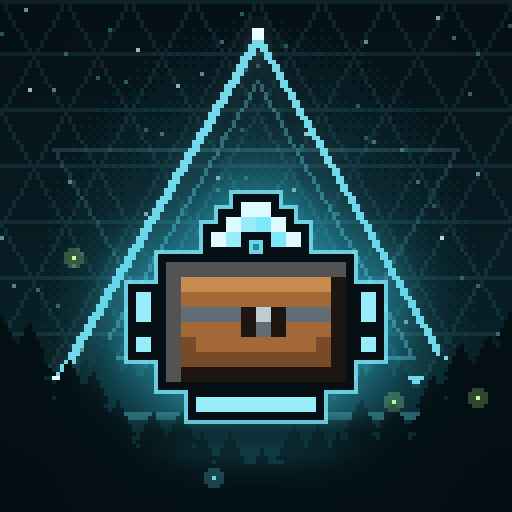

# LiftOff



[](https://github.com/MiracleForest/LiftOff/actions/workflows/build.yml)
[](COPYING.LESSER)

Pick up chests, blocks and mobs and carry them in your arms. LiftOff is a LeviLamina mod for Minecraft Bedrock Edition that works on dedicated servers and in single-player worlds.

## How to play

- **Pick up**: with both hands empty, hold the Carry key (default Left Shift; on a vanilla client: sneak) and use
  (right-click) a block that has contents, such as a chest, or a mob. You carry it in both arms and walk slower,
  the heavier the load. Players can be carried too.
- **Put down**: use a block while carrying. Blocks keep their contents; mobs keep their name, health and data.
- **Stack**: use a mob while carrying a mob to put it on top.
- While carrying you cannot switch the hotbar slot, use items, open containers, break blocks or attack.

Servers can choose what may be carried (black/whitelists, scripts, custom pickup conditions); see
[docs/SPEC.md](docs/SPEC.md) for the complete behaviour.

Players without the client mod can still pick up and put down everything. They see the arm pose and a stand-in
of the carried block or mob (a carried chest shows no block), but no first-person view of the load.

### Known limitations

- In first person a carried mob is a client-side stand-in of its type: its variant, colours, age, saddle, chest,
  shorn wool, armour and held items come from the carried data. Its size comes from the mob your client saw picked
  up, another mob of that kind it has seen, or a table of vanilla mob sizes (a modded mob of a kind the client has
  never seen is sized as one block). An armour stand (blacklisted by default) is not drawn in first person.
- Players without the client mod may briefly see the hotbar slot change or the block-breaking crack while carrying.

## Install

You need Minecraft Bedrock Edition for Windows (x64) with LeviLamina (on a client, installed through [LeviLauncher](https://github.com/LiteLDev/LeviLauncher)). A LiftOff release is built against each LeviLamina line it supports, for the dedicated server and for the client, and you pick the one that matches your game:

| Minecraft | LeviLamina | Variant | Server download | Client download |
| --- | --- | --- | --- | --- |
| 1.26.60 | 26.60.x | `26_60`, and the default | `liftoff-server-win-x64-ll26.60.zip` | `liftoff-client-win-x64-ll26.60.zip` |
| 1.26.51 | 26.51.x | `26_51` | `liftoff-server-win-x64-ll26.51.zip` | `liftoff-client-win-x64-ll26.51.zip` |

On a client, install LiftOff from the **LeviMC Mods** page of LeviLauncher; it offers the variants above, and the default is the newest line.

With [lip](https://github.com/LiteLDev/lip) 0.40.0 or later, on a dedicated server or a client (lip picks the build for the side of the folder you install into):

```sh
lip install github.com/MiracleForest/LiftOff#26_60
lip install github.com/MiracleForest/LiftOff#26_51   # to stay on Minecraft 1.26.51
```

Each variant is a package of its own to lip: to switch, uninstall the one you have first (your configuration is kept).

`lip install github.com/MiracleForest/LiftOff`, the default variant, is the newest line too.

Or download the zip for your side and line from the [latest release](https://github.com/MiracleForest/LiftOff/releases/latest) and extract it into a `LiftOff` folder, next to `LeviLamina/`, so that `LiftOff/manifest.json` exists:

| Where | Folder |
| --- | --- |
| Dedicated server, LeviLamina 26.60 | `mods/LiftOff/` |
| Dedicated server, LeviLamina 26.51 | `plugins/LiftOff/` |
| Client (LeviLauncher) | `mods/LiftOff/` |

## Commands

| Command | Who | What it does |
| --- | --- | --- |
| `/liftoff debug` | Everyone | Shows what you carry (block, state, NBT / entity, name, NBT). |
| `/liftoff clear` | Everyone | Deletes what you carry without placing it. |
| `/liftoff clear <targets>` | Operators | Deletes what the targets carry. |
| `/liftoff place [targets]` | Operators | Puts down what you / the targets carry, at the nearest free spot. |
| `/liftoff reload` | Operators, console | Reloads the configuration and translations. |
| `/liftoff selftest ["glob"]` | Operators, console | Runs the in-game selftests. |

## Configuration

Settings live in `config/*.json` inside the mod folder (`mods/LiftOff/`, or `plugins/LiftOff/` on a LeviLamina 26.51 server). Each file is created with defaults on first start; `/liftoff reload` applies changes. On a server, a client with the mod applies changes to its own `liftoff_client.json` by itself within about a second.

| File | Setting | Default | Meaning |
| --- | --- | --- | --- |
| `mod.json` | `language` | `en_US` | Language of server messages when a player's own language has no translation. |
| | `usePlayerLocale` | `true` | Use each player's game language when a translation exists. |
| | `requireResourcePack` | `true` | Dedicated server: players must accept the resource pack to join. |
| `liftoff.json` | `settings.maxDistance` | `2.5` | How far away (blocks) something can be picked up. |
| | `settings.scaleDistance` | `true` | Scale the distance with the reach (longer in creative). |
| | `settings.maxEntityWidth` / `maxEntityHeight` | `1.5` / `2.5` | Largest mob that can be picked up in survival. |
| | `settings.relativePlayerScale` | `true` | Mob sizes relative to the carrier's size. |
| | `settings.heavyTiles` / `heavyEntities` | `true` | Heavier blocks (more contents) and bigger mobs slow you down more. |
| | `settings.blockSlownessMultiplier` / `entitySlownessMultiplier` | `1.0` | Scale the slowness. |
| | `settings.slownessInCreative` | `true` | Slow down creative players too. |
| | `settings.pickupAllBlocks` | `false` | Allow blocks without contents (stone, ...). |
| | `settings.pickupUnbreakableBlocks` | `false` | Allow unbreakable blocks in survival. |
| | `settings.pickupHostileMobs` | `false` | Allow monsters in survival. |
| | `settings.allowBabies` | `false` | Baby mobs ignore the entity lists. |
| | `settings.pickupPlayers` | `true` | Allow carrying players. |
| | `settings.stackableEntities` | `true` | Allow stacking mobs. |
| | `settings.maxEntityStackLimit` | `10` | Highest mob stack. |
| | `settings.entitySizeMattersStacking` | `true` | Only smaller (or equal) mobs go on top. |
| | `settings.hitWhileCarrying` | `false` | Allow breaking blocks and attacking while carrying. |
| | `settings.dropCarriedWhenHit` | `false` | Drop what you carry when you take damage. |
| | `settings.useScripts` | `false` | Enable scripts (`config/scripts/`). |
| | `settings.useWhitelistBlocks` / `useWhitelistEntities` / `useWhitelistStacking` | `false` | Use the whitelists instead of the blacklists. |
| | `settings.placementStateExceptions` | (list) | Block states recomputed when a block is put down. |
| | `blacklist.forbiddenTiles` / `forbiddenEntities` / `forbiddenStacking` | (lists) | What can never be picked up / stacked on. |
| | `whitelist.allowedBlocks` / `allowedEntities` / `allowedStacking` | `[]` | What can be, in whitelist mode. |
| | `customPickupConditions.customPickupConditionsBlocks` / `...Entities` | `[]` | Pickups that need a stage (player tag `liftoff:stage:<name>`). |
| `liftoff_client.json` | `settings.facePlayer` | `false` | Carried blocks face you. |
| | `settings.rotateEntitiesSideways` | `false` | Carried mobs are held sideways. |
| | `settings.renderArms` | `true` | Show the arms holding the load. |
| | `modelOverrides.modelOverrides` | (list) | Draw some blocks as another block or item. |

List entries are ids (`minecraft:chest`), wildcards (`minecraft:*_door`), tags (`#tag`) or ids with states (`minecraft:seagrass[sea_grass_type=double_top]`).

## Contributing

See [CONTRIBUTING.md](CONTRIBUTING.md). [AGENTS.md](AGENTS.md) is the developer guide.

## License

[LGPL-3.0-only](COPYING.LESSER) (with the [GPL-3.0](COPYING) text it builds on). See [NOTICE](NOTICE) for third-party notices.
